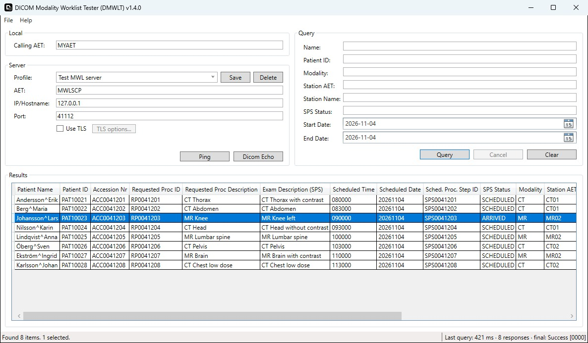
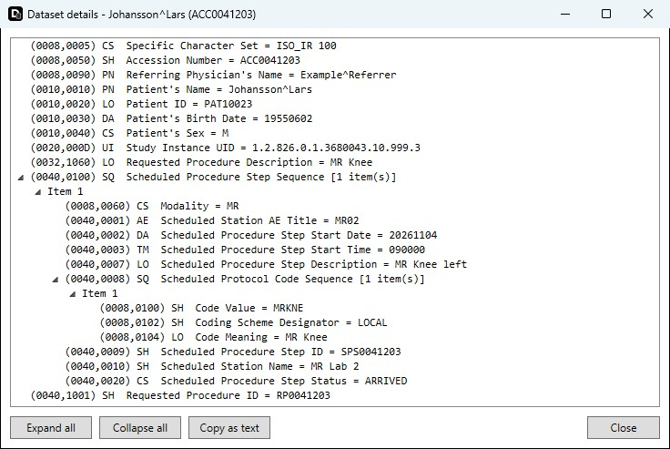
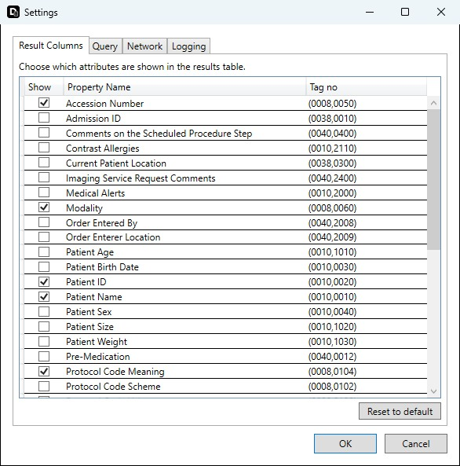
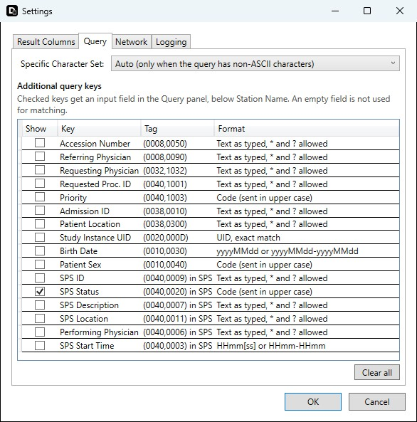

#  DICOM Modality Worklist Tester

**DICOM Modality Worklist Tester** is a lightweight, standalone utility designed to simulate a Modality (SCU) for testing and verifying DICOM Modality Worklist (MWL) services on a PACS or RIS (SCP).

Built on the robust **Fellow Oak DICOM (fo-dicom)** library, this tool provides a reliable way to query worklists without the need for complex installation or heavy runtimes.

To test DICOM C-STORE and generate test images, see the companion tool [DCST4 – DICOM C-Store Tester 4](https://github.com/droidgren/DCST4).

## Table of Contents
* [Features](#features)
* [Screenshots](#screenshots)
* [Supported DICOM Tags](#supported-dicom-tags)
* [Requirements](#requirements)
* [Installation](#installation)
* [Usage](#usage)
* [Changelog](#changelog)
* [Reporting Bugs & Feature Requests](#reporting-bugs--feature-requests)
* [License](#license)
* [Acknowledgments](#acknowledgments)

## Features

* **Zero Dependencies:** Built on .NET 4.8 (included natively in Windows 10 and 11). No external runtime installation is required.
* **Flexible Deployment:** Available as a portable executable or MSI installer.
* **Customizable Results:** Select exactly which DICOM tags to display in the results table via the Settings menu. Column order and widths are saved between sessions, and **Reset to default** restores the original table.
* **Flexible Queries:** Besides name, patient ID, modality, station and date, add any of 16 extra matching keys (e.g. Accession Number, Requested Procedure ID, SPS Status, Referring Physician) to the Query panel in **File -> Settings -> Query**.
* **Filter and Details:** Filter the returned rows by text (**File -> View Filter Results**, Ctrl+F), and double-click a row to see the complete returned dataset, including sequences and private tags.
* **Built-in Help:** **Help -> Help** (F1) opens a guide to every function, with a troubleshooting section.
* **Connection Profiles:** Save the settings for several worklist servers under a name and switch between them.
* **Connectivity Tools:** Integrated network **Ping** and DICOM Verification (**C-ECHO**) to troubleshoot connection issues before querying.
* **Cancel and Timeouts:** Cancel a running query or echo, and set the connection, association and response timeouts.
* **Query Statistics:** The status bar shows the time, the number of responses (and FF01 warnings) and the final status of the last query.
* **Secure:** Full support for **TLS** (Transport Layer Security), with an option to accept self-signed server certificates and to authenticate with a client certificate from the Windows certificate store.
* **Deep Logging:** Extensive logging settings to analyze communication traffic and debug DICOM associations.
* **Version Check:** A window at startup tells you when a new version is available. It can be turned off in **File -> Settings -> Updates**.
* **Open Source:** Free to use, modify, and distribute under the MIT License.

## Screenshots

**Main window** — results of a worklist query, with a saved connection profile and an additional query key (SPS Status):

**Dataset details** — double-click a row to see the full dataset returned by the server:

**Settings** — choose the result columns and the additional query keys:

##  Supported DICOM Tags

The application handles the following DICOM tags. You can configure which of these tags are visible in the result grid via the **File -> Settings** menu.

| Tag Name | Tag ID | Description |
| :--- | :--- | :--- |
| `SpecificCharacterSet` | (0008,0005) | Specific Character Set of the response |
| `PatientName` | (0010,0010) | Patient's Name |
| `PatientID` | (0010,0020) | Patient ID |
| `PatientBirthDate` | (0010,0030) | Patient's Birth Date |
| `PatientSex` | (0010,0040) | Patient's Sex |
| `PatientAge` | (0010,1010) | Patient's Age |
| `PatientSize` | (0010,1020) | Patient's Size |
| `PatientWeight` | (0010,1030) | Patient's Weight |
| `MedicalAlerts` | (0010,2000) | Medical Alerts |
| `Allergies` | (0010,2110) | Contrast Allergies |
| `AccessionNumber` | (0008,0050) | Accession Number |
| `StudyInstanceUID` | (0020,000D) | Study Instance UID |
| `Modality` | (0008,0060) | Modality |
| `ReferringPhysicianName` | (0008,0090) | Referring Physician's Name |
| `RequestingPhysician` | (0032,1032) | Requesting Physician |
| `RequestedProcedureDescription` | (0032,1060) | Requested Procedure Description |
| `RequestedProcedureCodeSequence` | (0032,1064) | Requested Procedure Code Sequence |
| `AdmissionID` | (0038,0010) | Admission ID |
| `CurrentPatientLocation` | (0038,0300) | Current Patient Location |
| `ScheduledStationAET` | (0040,0001) | Scheduled Station AE Title |
| `ScheduledDate` | (0040,0002) | Scheduled Procedure Step Start Date |
| `ScheduledTime` | (0040,0003) | Scheduled Procedure Step Start Time |
| `ScheduledPerformingPhysicianName`| (0040,0006) | Scheduled Performing Physician's Name |
| `ExamDescription` | (0040,0007) | Scheduled Procedure Step Description (Exam Description) |
| `ScheduledProtocolCodeValue` | (0040,0008) | > (0008,0100) Code Value |
| `ScheduledProtocolCodeMeaning` | (0040,0008) | > (0008,0104) Code Meaning |
| `ScheduledProtocolCodeScheme` | (0040,0008) | > (0008,0102) Coding Scheme Designator |
| `ScheduledProcedureStepID` | (0040,0009) | Scheduled Procedure Step ID |
| `ScheduledStationName` | (0040,0010) | Scheduled Station Name |
| `ScheduledProcedureStepLocation` | (0040,0011) | Scheduled Procedure Step Location |
| `PreMedication` | (0040,0012) | Pre-Medication |
| `ScheduledProcedureStepStatus` | (0040,0020) | Scheduled Procedure Step Status |
| `CommentsOnScheduledProcedureStep` | (0040,0400) | Comments on the Scheduled Procedure Step |
| `RequestedProcedureID` | (0040,1001) | Requested Procedure ID |
| `ReasonForRequestedProcedure` | (0040,1002) | Reason for Requested Procedure |
| `RequestedProcedurePriority` | (0040,1003) | Requested Procedure Priority |
| `OrderEnteredBy` | (0040,2008) | Order Entered By |
| `OrderEntererLocation` | (0040,2009) | Order Enterer Location |
| `ImagingServiceRequestComments` | (0040,2400) | Imaging Service Request Comments |

## Requirements

* **OS:** Windows 10 or Windows 11.
* **Framework:** .NET Framework 4.8 (Pre-installed on supported OS).

## Installation

You can choose between the Windows Installer or the Portable version. Neither requires administrative privileges.

### Option 1: Installer
1. Download the **MSI Installer** from the [latest release](../../releases/latest).
2. Double-click the file to install the application.
3. Launch **DICOM Modality Worklist Tester** from your Start Menu.

The installer installs for the current user only, by default to `%LOCALAPPDATA%\DICOM Modality Worklist Tester`, and does not ask for administrator rights.

> **Upgrading from 1.2 or earlier:** older installers installed for all users in Program Files. The new per-user installer cannot remove those, so uninstall the old version first (**Settings -> Apps -> Installed apps**). Removing the old version may require administrator rights.

### Option 2: Portable
1. Download the **ZIP file** from the [latest release](../../releases/latest).
2. Extract the files to a folder of your choice.
3. Run `DMWLT4.exe`.

### ⚠️ Microsoft SmartScreen Warning
Because this is an open-source tool and is not digitally signed with a paid certificate, you may see a **"Windows protected your PC"** warning (Microsoft Defender SmartScreen) when you try to run the application for the first time.

To proceed:
1. Click **More info**.
2. Click **Run anyway**.

This is a standard warning for unsigned software and does not indicate a security threat.

## Usage

1. **Configure Connection:** Enter the IP, Port, and AE Title of the target Worklist SCP (RIS/PACS). For TLS, check **Use TLS** and open **TLS options...** to accept self-signed certificates or pick a client certificate.
2. **Set Local AE:** Configure your local Calling AE Title.
3. **Save a Profile (optional):** Type a name in the **Profile** box and click **Save**. Pick the profile later to restore all connection settings.
4. **Test Connection:** Use the **Ping** or **DICOM Echo** buttons to verify network visibility.
5. **Query:** Enter search criteria (e.g., Modality, Date, or Patient Name) and execute the query. Use **Cancel** to stop a slow query. To match on other attributes, add them under **File -> Settings -> Query -> Additional query keys**.
6. **Review:** Check the results list. Use **File -> View Filter Results** (Ctrl+F) to show the filter bar and narrow it down, and double-click a row to see the full dataset. You can customize visible columns, timeouts and the character set via **File -> Settings**.

Press **F1** or choose **Help -> Help** for the built-in guide.

### Version check

When the program starts, it asks GitHub for the latest release (`api.github.com`). If there is a new version, a window opens with a link to it and the release notes, which are collapsed until you open them. You only see this window when a new version was found: if GitHub cannot be reached, for example on a closed network, the program says nothing and carries on, and the failure is written to the log.

To turn this off, untick **Show a window at startup when a new version is available** under **File -> Settings**, on the **Updates** tab. Nothing is then sent at startup.

Opening **Help -> About** also asks GitHub and shows the result in that window, including if the check failed. Nothing is sent except an ordinary web request with the program's version as its User-Agent, and nothing is downloaded or installed.

## Changelog

### 1.4.1

**New**
* A window at startup when a new version is available, with a link to it and the release notes, collapsed until opened. A check that fails is only written to the log.
* Setting to turn this window off, on the **Updates** tab under **File -> Settings**. Nothing is then sent to GitHub at startup.
* **Help -> About** shows whether a new version is available, with a link to it.

**Fixes**
* A shortcut pinned to Start is now kept when the program is updated with the MSI. The update from an earlier version may still lose the pin once.

### 1.4.0

**New**
* Additional query keys: choose extra matching keys in **File -> Settings -> Query** and they appear as fields in the Query panel. Available: Accession Number, Referring Physician, Requesting Physician, Requested Procedure ID, Requested Procedure Priority, Admission ID, Current Patient Location, Study Instance UID, Patient Birth Date, Patient Sex, and in the Scheduled Procedure Step: SPS ID, SPS Status, SPS Description, SPS Location, Scheduled Performing Physician and SPS Start Time.
  * Values are sent as typed (no automatic wildcard), codes in upper case. Dates and times can be ranges and are checked before the query is sent.
* New result column: Referring Physician (0008,0090). It is now also requested in every query.

**Changed**
* The Settings dialog is organized in tabs: Result Columns, Query, Network and Logging.

### 1.3.0

**New**
* Row details: double-click a row to see the complete returned dataset as a tree, with all sequences, items and private or unknown tags. The dataset can be copied as text.
* Cancel button for a running query or echo. Rows already received are kept.
* Configurable connection, association and response timeouts (**File -> Settings -> Network**). A query or echo that times out is now ended right away instead of waiting for the server.
* TLS options: accept self-signed or invalid server certificates, and authenticate with a client certificate from the Windows certificate store (Current User\Personal).
* Connection profiles: save and switch between named server configurations (Calling AET, AET, host, port and TLS options).
* Character set option (**File -> Settings -> Query**): Auto (as before), ISO_IR 100 (Latin-1) or ISO_IR 192 (UTF-8).
* New result column: Character Set (0008,0005) of each response.
* Query statistics in the status bar: elapsed time, number of responses, FF01 warnings and the final status code.
* Filter bar above the results table. It searches the visible columns and is not case sensitive. It is hidden by default; show or hide it with **File -> View Filter Results** (Ctrl+F). Hiding it clears the filter.
* In-app help guide: **Help -> Help** (F1).
* The order and width of the result table columns are saved between sessions.
* **Reset to default** in the Settings dialog restores the default visible columns and the original column order and widths.

**Changed**
* The Server panel has a cleaner layout with the new Profile and TLS options controls.

### 1.2.1

**Fixes**
* Worklist results returned with status FF01 (Pending – optional keys not supported) are no longer dropped. A warning is shown if the query does not end with Success.
* Multi-valued attributes are now shown instead of being left empty.
* Query, Echo, Ping and Clear are disabled while a request is running, so a double-click or a second Enter no longer starts two queries into the same results table.
* Patient names with non-ASCII characters (e.g. "Åström") are now sent with the correct Specific Character Set (0008,0005) and match as expected.
* DICOM Echo now checks the response status and only reports success if the SCP returns Success. The round-trip time is shown.
* A cleared date picker now means an open date range, and a start date after the end date gives a warning instead of an empty result.
* Modality is converted to uppercase, so "ct" works the same as "CT".
* Typing your own `*` or `?` in Patient Name no longer produces a double wildcard (`DOE**`).
* Query checks for an empty host and a port outside 1–65535 before connecting.
* Status messages (e.g. "Echo successful", "results may be incomplete") stay visible after selecting a row.
* Cancel in the Settings dialog now discards changes to the logging options.
* Corrected the tag number shown for Reason for the Requested Procedure (0040,1002).
* The results table is now read-only, and rows can no longer be deleted with the Delete key.
* A corrupt settings file is now logged instead of silently resetting all settings, and settings are saved safely through a temporary file.
* Unexpected errors are now written to the log before the application closes.
* Connection errors now show the actual cause (e.g. connection refused) instead of "One or more errors occurred".
* Warning and error message boxes are now titled "Warning" and "Error" instead of always "Information".
* Corrected the DICOM tag table in this README.

**New**
* New result column: SPS Comments (0040,0400).

**Updated**
* fo-dicom 5.2.6, Serilog 4.4.0, Microsoft.Extensions 10.0.14 and other NuGet packages updated to their latest versions.

##  Reporting Bugs & Feature Requests

If you encounter any bugs or have an idea for a new feature, please open an issue in the [Issues](../../issues) section of this repository.

* **Bugs:** Please provide steps to reproduce the issue and attach relevant logs if possible.
* **Features:** Describe the desired functionality and how it would improve the tool.

## 📄 License

This project is licensed under the MIT License - see the [LICENSE](LICENSE) file for details.

## 🙏 Acknowledgments

* Powered by [Fellow Oak DICOM (fo-dicom)](https://github.com/fo-dicom/fo-dicom).
* Original GUI idea by [Sonny Pate](https://github.com/sonnypate/MWL-Tester/tree/main/MWL-Tester) project which is built on .NET 8.

---

> **Disclaimer:** This software is intended for testing and simulation purposes only. It is not certified for clinical use or primary diagnosis.
